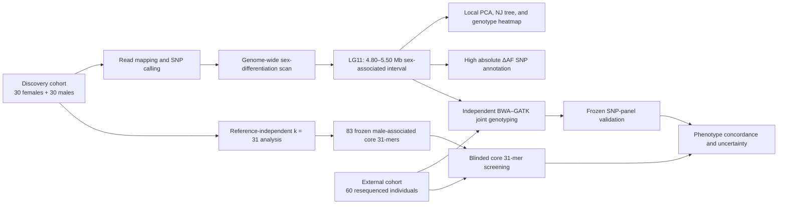

# Reproducible analysis of a sex-associated interval in *Chelidonichthys spinosus*

This repository reconstructs the computational workflow supporting the manuscript on a sex-associated interval on linkage group 11 (LG11) in *Chelidonichthys spinosus*. It is designed for two complementary levels of reuse:

1. **Paper-level reproduction**: regenerate manuscript figures, tables, and reported summary statistics from deposited source data and frozen intermediate files.
2. **Read-data reanalysis**: repeat read mapping, variant discovery, genome scans, local population-genetic analyses, k-mer screening, and external validation after the quality-filtered Illumina reads and required references have been deposited.

The repository is a release candidate, not yet a citable public release. It will be frozen only after the sequence-archive accessions, data DOI, and code DOI have been assigned and the remaining reproducibility audit items have been resolved.

## Evidence design



## Quick start

### A. Reproduce figures and summary tables

```bash
conda env create -f environment/figure_environment.yml
conda activate cspinosus-figures
bash workflow/run_source_data_checks.sh
```

This route uses only `source_data/` and `supplementary_tables/` and recomputes the central reported counts. It is the appropriate numerical smoke test for a journal or reviewer. Portable end-to-end figure renderers are still a release blocker; `workflow/run_figures.sh` reports that status and does not claim to regenerate figures silently.

### B. Reanalyse the discovery cohort

1. Copy `config/config.example.yaml` to `config/config.yaml`.
2. Populate `metadata/discovery_samples.template.tsv` with SRA/ENA/GSA accessions or local FASTQ paths.
3. Supply the exact discovery reference FASTA and GFF3 described in `docs/REFERENCE_PROVENANCE.md`.
4. Run the numbered scripts in `workflow/scripts/discovery/`, followed by the analysis modules listed in `docs/WORKFLOW_EN.md`.

### C. Reanalyse the external cohort

The external cohort was processed independently using a BWA–GATK gVCF workflow. Populate `metadata/external_samples.template.tsv`, then follow `docs/WORKFLOW_EN.md#external-validation-cohort`.

## Repository map

| Path | Purpose |
|---|---|
| `docs/WORKFLOW_CN.md` | Complete Chinese workflow and decision logic |
| `docs/WORKFLOW_EN.md` | Publication-ready English workflow |
| `docs/DATA_DEPOSITION_PLAN.md` | SRA/GSA, GitHub, and Zenodo release plan |
| `docs/SRA_GITHUB_ZENODO_RELEASE_STEPS.md` | Step-by-step archive and code-release procedure |
| `docs/REPRODUCIBILITY_AUDIT.md` | Known gaps, discrepancies, and release blockers |
| `metadata/` | Sample manifests and provenance templates |
| `source_data/` | Data underlying each main and supplementary figure |
| `supplementary_tables/` | Machine-readable supporting tables |
| `workflow/scripts/` | Analysis scripts grouped by discovery, k-mer, external validation, and figures |
| `workflow/legacy_lsf/` | Exact historical cluster scripts retained for provenance |
| `environment/` | Reproducible software environments |

## Frozen analytical decisions

- Discovery cohort: 60 individuals, comprising 30 females and 30 males.
- Genome scan: 200-kb windows with a 50-kb step.
- Sex-associated interval: LG11:4,800,000–5,500,000 on the discovery reference.
- Local structure: 3,310 candidate-interval SNPs; 2,533 retained after local LD thinning.
- High-differentiation threshold: `|Delta AF| >= 0.3`.
- Genome-wide calibration: 500 sex-label permutations, using seeds 1–500.
- k-mer discovery: canonical `k = 31`; 83 core male-associated markers were frozen before external screening.
- External cohort: 60 resequenced individuals, comprising 23 phenotypically confirmed males, 35 phenotypically confirmed females, and 2 phenotype-indeterminate individuals (Ibaraki3 and S8).
- The two phenotype-indeterminate individuals were retained in genomic analyses but excluded from performance calculations requiring confirmed phenotypic sex.
- BY1 and BY5 were phenotypically confirmed females but were classified as low-evidence/inconclusive in the strict 31-mer classification.

## Sequencing provenance

The discovery cohort used paired-end, 150-bp analysis-ready reads. The provider report records 663.24 Gb of clean data across 60 individuals (mean 11.05 Gb per sample), a mean mapping rate of 98.32%, and a mean mapped depth of 16.87×.

The detailed provider-report extraction, including documented library preparation and filtering, is available in `docs/SEQUENCING_PROVENANCE_2026-10-12.md`. Sequencing used an Illumina NovaSeq 6000 platform.

Archive-metadata drafts are generated with:

```bash
python workflow/build_sra_metadata.py
```

Locality, collection date, tissue, and FASTQ checksums must be generated or verified immediately before SRA transfer. External-cohort collection dates are intentionally omitted because no reliable primary date is available for every individual.

## Citation

Until a versioned Zenodo release exists, cite the associated manuscript and the relevant Git commit hash. Add the version DOI to `CITATION.cff` after the GitHub release has been archived by Zenodo.

## Licence

Code is released under the MIT License (`LICENSE`). Author-owned processed data, metadata, and source data are released under CC BY 4.0 (`LICENSE_DATA.md`).